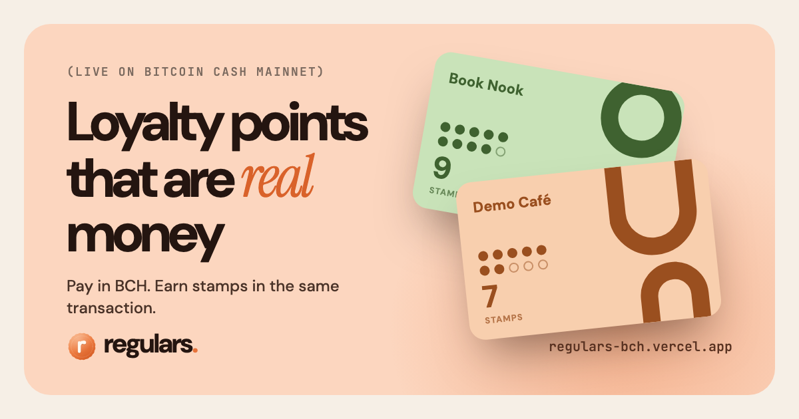
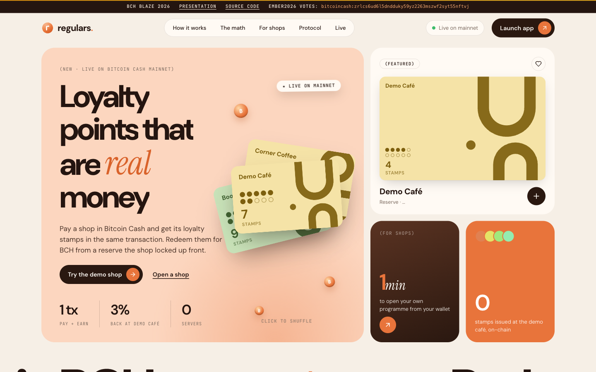
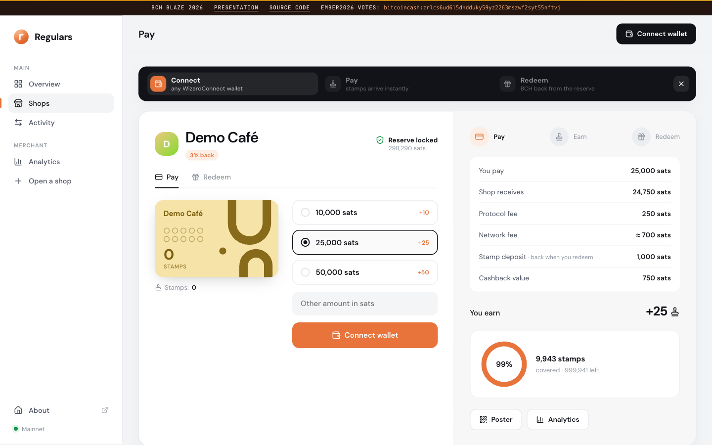
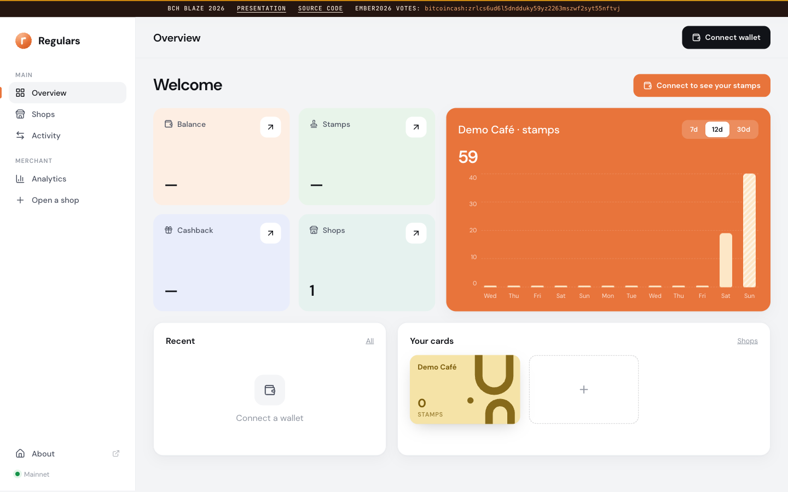
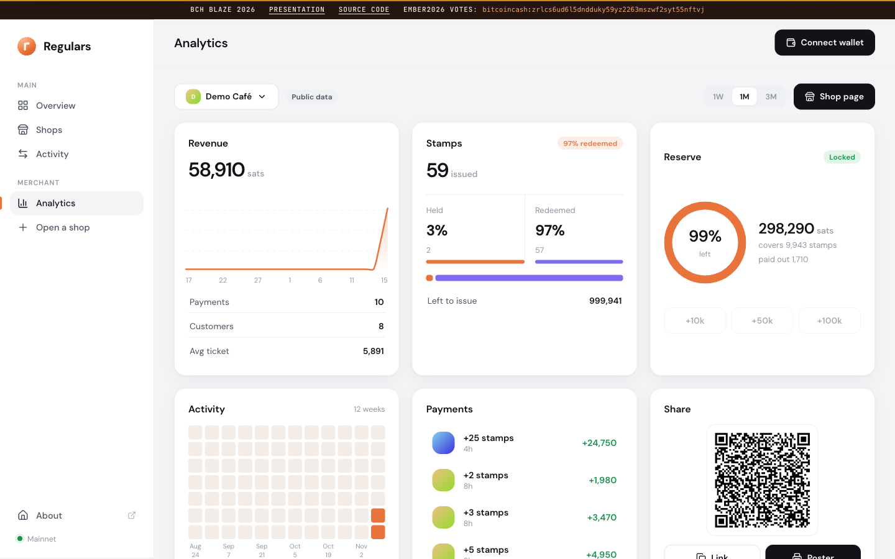
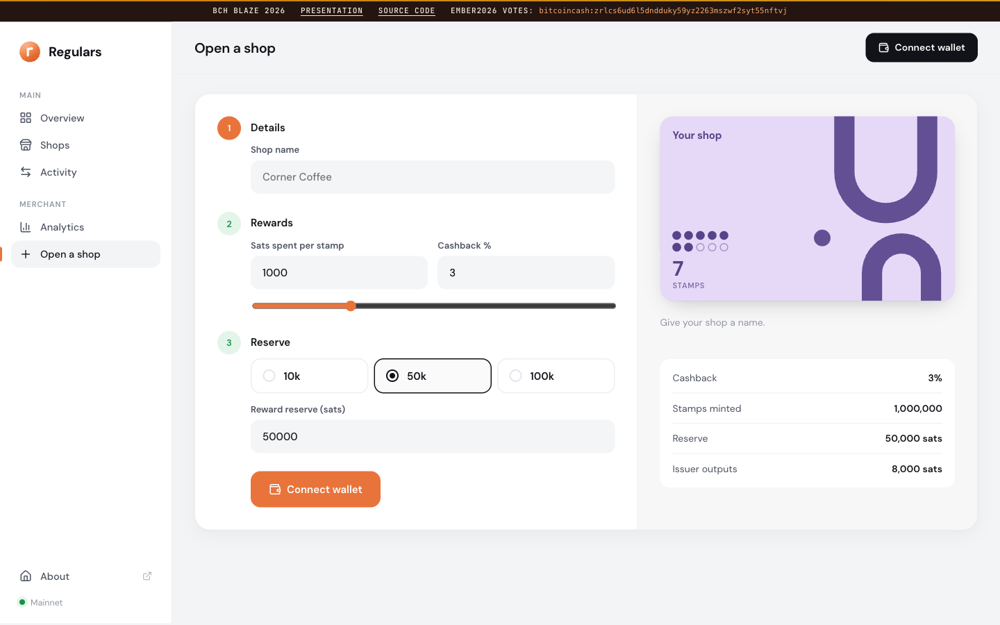
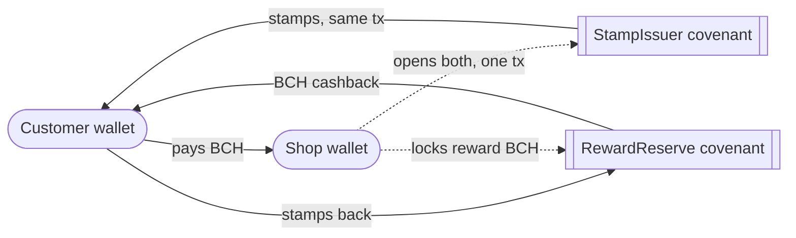

<div align="center">



<h1>Regulars</h1>

<p><b>Loyalty points that are real money.</b><br/>
A loyalty protocol on Bitcoin Cash with no backend: pay a shop, get stamps in the same transaction, redeem them for BCH the shop locked up front.</p>

<p>
<a href="https://regulars-bch.vercel.app"></a>
<a href="https://youtu.be/5ElVnEt-6Ow"></a>
<a href="https://docs.google.com/presentation/d/1RxO2ur5DGFXfTMQYQLL3Z7BUJ21l8KPd_lvPzDl7blc/edit?usp=sharing"></a>
</p>

<p>


</p>

<p>
<a href="https://regulars-bch.vercel.app">Live app</a> ·
<a href="https://youtu.be/5ElVnEt-6Ow">Watch the demo</a> ·
<a href="#how-it-works">How it works</a> ·
<a href="#quick-start">Quick start</a> ·
<a href="xo/README.md">XO template</a>
</p>

<p><sub><b>BLAZE starting point (Nov 14):</b> <a href="https://regulars-xri7qw8xe-codeswithrohs-projects.vercel.app">demo as it was</a> · <a href="https://github.com/codeswithroh/regulars/tree/blaze-start">code at that point</a> (tag <code>blaze-start</code>)</sub></p>

</div>

---

## Demo

<div align="center">
<a href="https://youtu.be/5ElVnEt-6Ow">

</a>
<p><sub>2 minutes · filmed on mainnet with a real wallet and real BCH</sub></p>
</div>

## Table of contents

- [The problem](#the-problem)
- [The fix](#the-fix)
- [Screenshots](#screenshots)
- [Features](#features)
- [How it works](#how-it-works)
- [Decentralized identity](#decentralized-identity)
- [Tech stack](#tech-stack)
- [Project layout](#project-layout)
- [Quick start](#quick-start)
- [Tests](#tests)
- [Deploy](#deploy)
- [Known limits](#known-limits)

## The problem

Loyalty points are IOUs in a database the shop owns. The shop decides what they are worth, changes
the rules, and if it shuts down, your points disappear.

## The fix

Regulars turns points into tokens you hold and BCH the shop can't take back.

- A customer pays a shop in BCH and receives **stamps** (a CashToken) **in the same transaction**.
- Stamps are redeemable for BCH from a **reward reserve** the shop locks up front. The shop cannot
  refuse a redemption.
- Any shop opens its programme with **one transaction** from its own wallet, then shares a link or
  prints a QR poster.

Two contracts and a static web page. No server, no database, no key held by anyone but the shop
and its customers.

## Screenshots

<table>
<tr>
<td width="50%"><p align="center"><b>Landing</b><br/><sub>Live stats read from the chain</sub></p></td>
<td width="50%"><p align="center"><b>Pay and earn</b><br/><sub>A full fee breakdown before you sign</sub></p></td>
</tr>
<tr>
<td width="50%"><p align="center"><b>Dashboard</b><br/><sub>Your cards, balance and cashback</sub></p></td>
<td width="50%"><p align="center"><b>Merchant analytics</b><br/><sub>Revenue, customers and reserve, straight from the chain</sub></p></td>
</tr>
<tr>
<td width="50%"><p align="center"><b>Open a shop</b><br/><sub>One transaction from the shop's own wallet</sub></p></td>
<td width="50%" align="center" valign="middle"><a href="https://regulars-bch.vercel.app"><b>Try it live →</b></a><br/><sub>Connect any WizardConnect wallet<br/>(tested with Cashonize)</sub></td>
</tr>
</table>

## Features

| | For customers | For shops |
|---|---|---|
| 💸 | Pay in BCH, earn stamps in the **same transaction** | Open a programme in **one transaction**, no sign-up |
| 🎁 | Redeem stamps for BCH any time; the shop **can't refuse** | Set your own earn rate, cashback and reserve |
| 👛 | Stamps live in **your own wallet** as CashTokens | Printable **QR poster** and a shareable shop link |
| 🔍 | Every fee shown before you sign | **Analytics** read from the chain: revenue, customers, redemptions |
| 🌐 | Works in any wallet that speaks WizardConnect, or any XO wallet via the [template](xo/README.md) | No server, no database, nothing to host but static files |
| 🪪 | Link your wallet to a **Nostr identity**, sign in to apps, get paid by npub | A **verified merchant** badge so customers know the shop is real |

## How it works



**`StampIssuer`** holds a shop's unissued stamps. `earn()` lets anyone take N stamps provided that,
in the same transaction:

1. the issuer is recreated at output 0 with N fewer stamps,
2. output 1 pays the shop at least `N × (satsPerStampEarned − feePerStamp)`,
3. the issuer's own balance grows by `N × feePerStamp` (the protocol fee).

`collect()` lets anyone forward accrued fees, but only to the protocol treasury. `withdraw()` lets
the shop reclaim unissued stamps; accrued fees still go to the treasury.

**`RewardReserve`** holds the shop's reward BCH. `redeem()` checks that the reserve is recreated,
that its stamp balance grew by N, and that at most `N × satsPerStamp` left. `withdraw()` is the
shop closing the reserve.

A shop is fully described by five values (name, token category, shop key hash, earn rate, redeem
rate), and both contract addresses follow from them. So a shop *is* its link:
`/#/s/<name>/<category>/<merchantPkh>/<earn>/<redeem>`. Nothing is registered anywhere.

## Decentralized identity

Regulars links a Bitcoin Cash wallet to a **Nostr identity**, so customers and shops can be found,
verified and paid across apps, with no identity provider in between. The full spec is in
[`identity/README.md`](identity/README.md).

- **Bind:** your Nostr key signs a NIP-39 identity event (kind `10011`) listing your BCH address.
  Your BCH key signs back the NIP-39 verification text, which names your npub. You can do this with
  "Sign message" in any wallet, or with an on-chain commitment from a WizardConnect wallet.
- **Discover:** look anyone up by npub, by NIP-05 name, or in reverse by BCH address, on public relays.
- **Verify:** both signatures are checked in the browser. An on-chain proof is re-run in the BCH
  virtual machine against the coins it spends.
- **Authenticate:** the [sign-in demo](https://regulars-bch.vercel.app/#/signin-demo) is a separate
  "Corner Coffee members" app that signs users in with challenge-response, using only the library and
  public relays.
- **Use it in Regulars:**
  - Shop pages show **"Run by …"** when the payout address is bound, which fixes copycat shop links.
  - You can pay a person by their verified identity.
  - Profiles show which shops someone is a regular at, as portable reputation.

The library is reusable on its own: `@regulars/bch-nostr-id` in [`identity/`](identity).

## Tech stack

| Layer | Built with |
|---|---|
| Contracts | [CashScript](https://cashscript.org) 0.14 covenants, CashTokens, [libauth](https://github.com/bitauth/libauth) |
| Web app | React 18, Vite 6, static hosting on Vercel |
| Wallets | [WizardConnect](https://www.npmjs.com/package/@wizardconnect/dapp) (tested with Cashonize), an [XO](xo/README.md) template |
| Identity | [Nostr](https://github.com/nostr-protocol/nips) (NIP-39, NIP-42, NIP-05, NIP-07) via nostr-tools, the Bitcoin Signed Message format |
| Chain data | Electrum servers with automatic failover |
| Tests | Vitest on CashScript's mock network, Playwright with a headless WizardConnect wallet |

## Project layout

| Folder | What it is |
|---|---|
| [`contracts/`](contracts) | The two covenants, the shared transaction builders, and tests |
| [`web/`](web) | The site: an animated landing page (`#/`) and a separate dashboard (`#/app`) with overview, shop checkout, activity, merchant analytics read from the chain, open-a-shop, and a printable poster |
| [`cli/`](cli) | Owner tools (open the demo shop, status, collect fees) and a live multi-customer check |
| [`e2e/`](e2e) | Browser tests: Chromium driven by Playwright, with a headless WizardConnect wallet |
| [`xo/`](xo) | An XO template so any XO wallet can earn and redeem |
| [`identity/`](identity) | `bch-nostr-id`: bind, discover, verify and authenticate BCH + Nostr identities |
| [`scripts/`](scripts) | Vercel static build |

## Quick start

```bash
npm install
npm run compile && npm test       # 23 covenant tests on CashScript's mock network
cp .env.example .env
npm run shop -- keygen            # writes a key to .env, prints the address to fund
# fund it from a chipnet faucet (https://tbch.googol.cash), then:
npm run shop -- open "Demo Café" 100000
npm run shop -- status
npm run dev                       # http://localhost:5173
```

Mainnet uses its own file: copy `.env.example` to `.env.mainnet`, set `NETWORK=mainnet` and
`VITE_NETWORK=mainnet`, and prefix commands with `ENV_FILE=.env.mainnet`.

The key in `.env` owns the demo shop, receives protocol fees and funds test wallets. The deployed
site never sees it.

## Tests

```bash
npm test                 # covenants: happy paths and attacks
npm test -w identity     # identity binding, proofs, tamper cases and sign-in (16 tests)
npm run test:e2e         # browser flows on chipnet (spends test coins from .env)
npm run e2e -w cli       # several customers paying at once, then a redemption
E2E_BASE_URL=https://your-site npm run test:e2e   # the same browser tests against a deployment
```

The browser suite pairs a headless wallet over the real WizardConnect relay and covers: pay and
earn, redeem, a rejected signature, an empty wallet, reconnecting after reload, a merchant opening
a shop from the UI, the poster, and broken links.

## Deploy

```bash
npm run deploy                         # chipnet build
ENV_FILE=.env.mainnet npm run deploy   # mainnet build
```

The output is static files only. No environment variables are needed on the host.

## Known limits

- Stamps are earned only by paying through the shop page (or any wallet that builds the same
  transaction). A plain payment scanned from an ordinary address QR earns nothing.
- Each issuer output serves one payment at a time; a shop has eight, and a customer who loses a
  race is asked to try again without being charged.
- Along with their stamps a customer's wallet sends 1,000 sats, the minimum a token output can
  hold. It comes back on redemption.
- The site reads the first 10 receive and 10 change addresses of the connected wallet.
- Shop links are self-describing, so a link can be crafted for a different shop with the same
  name. Shops that link their payout address to a Nostr identity show a "Run by …" badge; for
  unverified shops, customers should get the link or poster from the shop itself.
- Closing a shop (`withdraw`) is implemented and tested in the contracts but has no button yet.

---

<div align="center">
<br/>
<sub>Built for <b>BCH BLAZE 2026</b> · <a href="https://regulars-bch.vercel.app">regulars-bch.vercel.app</a> · <a href="#regulars">Back to top ↑</a></sub>
</div>
